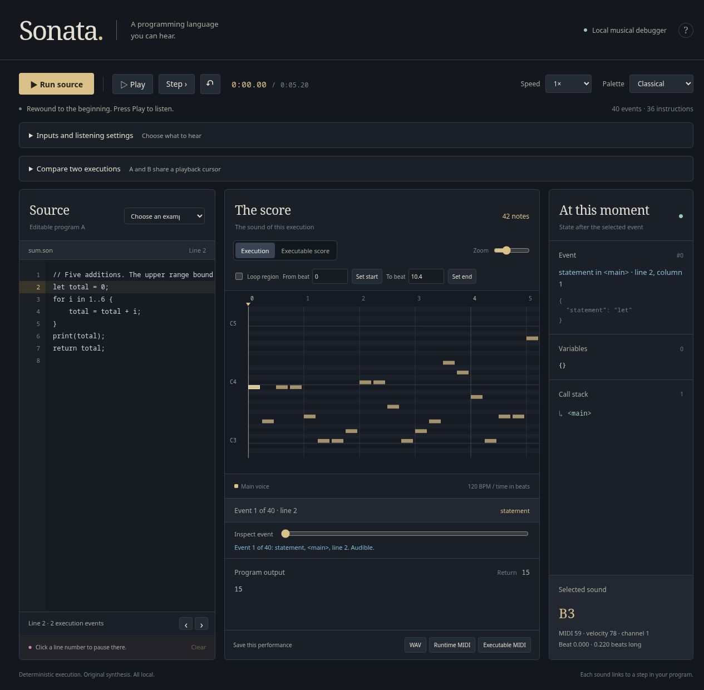

# SONATA 1.0

**Write an algorithm. Hear it execute. Change the algorithm. Hear what changes.**

SONATA is a programming language, an executable musical score format, and a
local audible debugger. It runs algorithms with integers, Booleans, arrays,
loops, functions, and recursion. Its source scores carry programs in actual
MIDI notes. Its execution music follows real control flow and state changes.

Change the sum example's upper bound from `6` to `5`: its result changes from
**15 to 10**, and a recurring phrase disappears. The debugger lets you compare
both runs, inspect their first divergence, and loop that musical region.



**Research status:** computation, MIDI round trips, and musical differences are
automatically tested. No human participant results have been collected. Whether
sonification improves debugging accuracy, speed, workload, or accessibility
remains an open research question.

## Install and start

Python **3.12 or later** is required. From a checkout of this repository:

```sh
python -m venv .venv
# Linux/macOS:
. .venv/bin/activate
# Windows PowerShell instead: .venv\Scripts\Activate.ps1
python -m pip install .
sonata debug --open
```

A downloaded release wheel also installs directly:

```sh
python -m pip install ./sonata_lang-1.0.0-py3-none-any.whl
sonata examples --output lessons
sonata run lessons/sum.son
sonata debug lessons/sum.son --open
```

The debugger defaults to `http://127.0.0.1:8765`. It includes its own web assets,
examples, and synthesized sounds. Core use needs no account, API key, MIDI
hardware, proprietary samples, or external web services. The distribution name
is `sonata-lang`; these instructions do not assume a PyPI publication.

Start with the [hands-on tutorial](docs/TUTORIAL.md), then use the
[language manual](docs/LANGUAGE_GUIDE.md), [listening guide](docs/LISTENING_GUIDE.md),
and [debugger manual](debugger/README.md).

## Write, perform, inspect

```sonata
let total = 0;
for i in 1..6 {
    total = total + i;
}
assert(total == 15);
print(total);
return total;
```

```sh
sonata run lessons/fibonacci.son --trace trace.json
sonata listen lessons/sum.son --semantic --wav performance.wav --midi performance.mid
sonata compile lessons/sum.son --midi program.mid
sonata decode program.mid --output recovered.son
sonata run recovered.son
sonata verify lessons/bubble_sort.son --report verification.json
sonata compare lessons/sum.son lessons/off_by_one.son --wav-dir comparison
```

The language has checked signed 64-bit arithmetic, strict Boolean conditions,
lexical scope, copied integer arrays, assertions, `break`/`continue`, bounded
math/array helpers, input fixtures, and local function modules. File-based tools
bundle modules before execution or musical compilation. See [SPEC.md](SPEC.md)
for grammar and exact operational semantics.

## Two kinds of musical representation

| Representation | What it encodes | What you can recover |
| --- | --- | --- |
| Executable source MIDI, SC1 | Canonical language tokens in pitches, operand melodies, and rhythmic cells | The bundled program's canonical AST and behavior, given the same inputs |
| Execution music | Actual events, data transformations, branches, calls, returns, and errors | Exact event links through the trace; the audible mapping itself is lossy |

MIDI metadata does not carry hidden source code. Removing that metadata still
leaves an executable SC1 score. Ordinary MIDI songs are musical input, not
SONATA programs. Source-score edits must obey SC1's grammar; the debugger's
musical token editor validates edits and regenerates the checksum. The
[encoding design](docs/ENCODING.md) describes the reversible domain.

## Debugger and music tools

- Edit source or executable musical token cells, then run and inspect the result.
- Step through recorded events, set playback breakpoints, inspect variables and
  the call stack, or select notes and source locations.
- Compare two programs or input fixtures with a shared cursor, first-divergence
  navigation, A/B audition, and repeatable listening regions.
- Filter by function, variable, or event kind. Muted events retain their original
  timing and remain inspectable.
- Choose classical, electronic, or ambient synthesis. Semantic profiles preserve
  motifs across source formatting changes and support explicit numerical ranges.
- Export WAV, runtime MIDI, executable MIDI, or separate voice stems.

The interpreter completes or reaches a configured limit before playback begins.
Breakpoints navigate the recording; they do not suspend a live interpreter.
Browser and offline renderers follow the same notes with different timbres.

The optional [MIDI integration](docs/MIDI_GUIDE.md) provides live output, bounded
input capture, timestamped replay, and conversion into deterministic SONATA input
fixtures. Install it from a checkout with `python -m pip install '.[midi]'`.
A small Python music library provides scales, chords, rational beat patterns,
named voices, and instrument selection. The [embedding guide](docs/EMBEDDING.md)
also explains how to sonify traces from trusted Python callables.

## Demonstrations

| Program | Result | Recording |
| --- | --- | --- |
| Sum 1 through 5 | `15` | [Correct loop](audio/demos/sum/execution.wav) |
| Off-by-one defect | `10` | [Defective loop](audio/demos/off_by_one/execution.wav) |
| Recursive Fibonacci | `5` | [Recursion tree](audio/demos/fibonacci/execution.wav) |
| Bubble sort | `[1, 2, 3, 4, 5]` | [Sorting execution](audio/demos/bubble_sort/execution.wav) |
| Binary search | index `4` / absent `-1` | [Found](audio/demos/binary_search/execution.wav), [absent](audio/demos/binary_search_miss/execution.wav) |
| Bounded runaway recursion | `DepthLimit` | [Growing recursion](audio/demos/infinite_recursion/execution.wav) |

Download the repository to open the [synchronized showcase](audio/showcase/index.html)
locally, or play the [demonstration video](audio/showcase/sonata-demo.mp4).
The listening guide links to smaller clips for learning individual cues.

## Intended uses

SONATA supports algorithm teaching, programming-language experiments, HCI
research, and computational art. Auditory regression inspection and nonvisual
interfaces are research directions requiring user evaluation. The project
includes a [small usability pilot](research/PILOT.md), a [controlled study
protocol](research/PROTOCOL.md), counterbalanced stimuli, empty response
forms, and analysis scripts. Automated signal measurements are reported
separately from human outcomes.

## Reproduce and contribute

```sh
bash scripts/build.sh
```

This installs pinned dependencies and runs the milestone, full test suite,
recording generation, signal experiments, study-kit generation, and artifact
verification. FFmpeg and fontconfig are optional for video creation. For
cross-platform development and distribution checks, see
[the release procedure](docs/RELEASE.md) and [CONTRIBUTING.md](CONTRIBUTING.md).

Verification compares execution with a separate reference evaluator, checks
source/trace/note correspondence, reimports MIDI, and measures actual WAV
samples. The parser and module bundler remain shared dependencies. Saved
reports disclose these limits; see [verification results](docs/verification/V1_RESULTS.md).

The source codec, trace/profile schemas, public Python APIs, and compatibility
policy are documented in [the release guide](docs/RELEASE.md). Resource limits
remain deliberate. This is not a hard real-time engine or a complete DAW.
Physical MIDI devices, individual DAWs, and human auditory effectiveness require
separate validation. [LICENSE](LICENSE) covers original project code and music;
third-party dependencies retain their own licenses.
